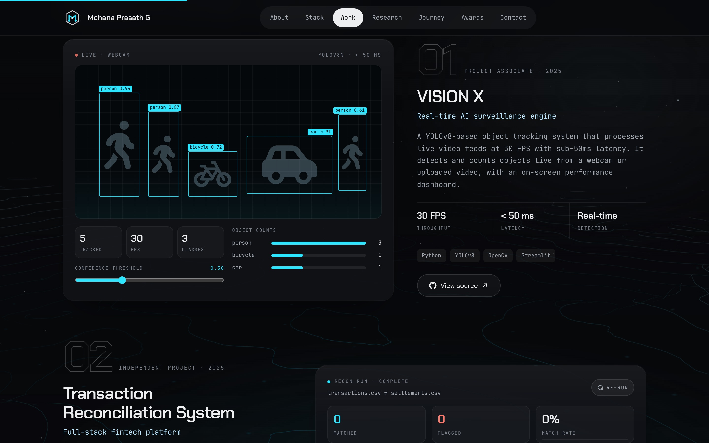
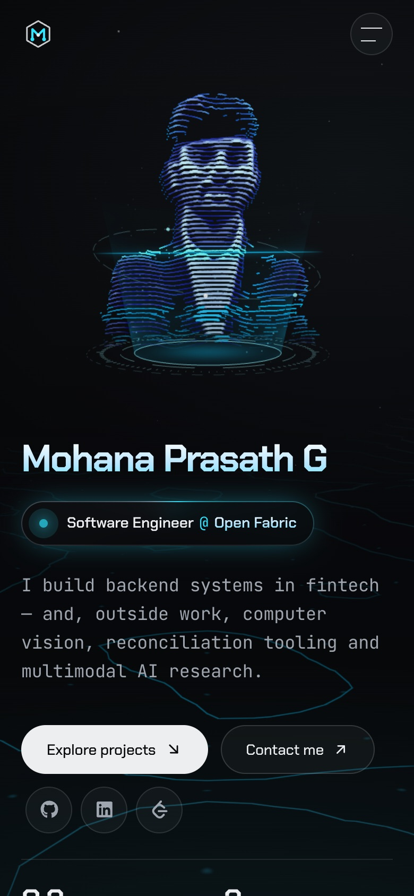
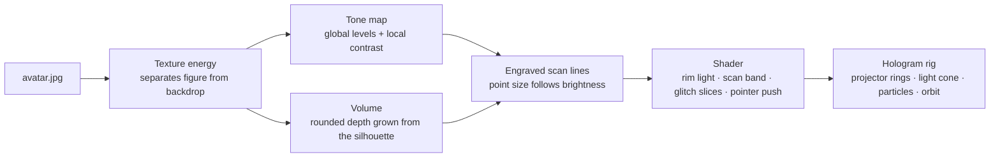

<div align="center">


# Mohana Prasath G

**Software Engineer @ Open Fabric** · backend systems in fintech, computer vision and multimodal AI

A portfolio that renders its owner as a **real-time 3D hologram**, sets it in a living topographic world,
and shows every project as an interactive dashboard instead of a screenshot.

[**Live site →**](https://mohana-prasath-2005.github.io/portfolio/)


</div>

---

## ✦ What makes it different

| | |
|---|---|
| **Holographic portrait** | A single photo turned into thousands of engraved scan-line points with real depth. A projector base, light cone, rising particles, an orbit ring and a sweeping scan beam complete the hologram. It turns toward your cursor, and the points part around it. |
| **A world behind the page** | A procedural terrain drawn as topographic contour lines. The camera glides along its valley as you scroll, and a pool of light follows the pointer. |
| **Projects you can use** | VISION X has a detection dashboard with a working confidence-threshold slider. The reconciliation engine runs a live matching pass that you can re-run. The robot car plays real footage of each control mode. |
| **One source of truth** | Every word on the site lives in [`src/data/profile.js`](src/data/profile.js). Change the content without touching a component. |

<div align="center">

&nbsp;

</div>

---

## ✦ How the hologram is built

There is no 3D model. The portrait is reconstructed in the browser from the 2D image on every load:



All of it is in [`src/three/Portrait.jsx`](src/three/Portrait.jsx). Add `?portrait=dots`, `?portrait=scan` or `?portrait=pins` to the URL to compare other renderings of the same data.

---

## ✦ Sections

| # | Section | Highlights |
|---|---|---|
| 01 | **About** | Scroll-resolving statement, spec sheet, the areas of work at Open Fabric |
| 02 | **Stack** | 26 tools across 6 layers |
| 03 | **Work** | VISION X · Transaction Reconciliation · 3-in-1 IoT Robot Car · CSE Department site |
| 04 | **Research** | Two multimodal emotion-recognition papers with animated method diagrams, plus hackathons |
| 05 | **Journey** | Open Fabric progression, NIT Trichy, CGPA 9.2 with a semester chart, credentials |
| 06 | **Leadership** | A staircase of roles on desktop; an expandable timeline on mobile |
| 07 | **Awards** | ISTE Chapter Best Student Award, departmental honours, competition record |
| 08 | **Contact** | Email, phone and profiles |

---

## ✦ Built to be fast and inclusive

- **Text first.** The WebGL bundle loads lazily when the browser is idle. Without WebGL, a static backdrop takes its place.
- **Loads on demand.** Project videos load and play only when scrolled into view, and pause when they leave it.
- **Reduced motion respected.** No smooth scroll or cursor follower, a still 3D frame, and dashboards that show their final state.
- **Accessible.** Skip link, visible focus, a focus-trapped mobile menu, ARIA on interactive visuals, and text alternatives for every diagram.
- **Responsive.** Tested down to 320 px. The 3D scene repositions itself for phones.

---

## ✦ Tech

| Layer | Tools |
|---|---|
| UI | React 18, Tailwind CSS 3 (tokens in `src/index.css`), Framer Motion 11 |
| 3D | Three.js, React Three Fiber, custom GLSL shaders |
| Motion | Lenis smooth scroll, scroll-linked transforms |
| Type | Chakra Petch (display), JetBrains Mono (body) |
| Build & ship | Vite 6, `gh-pages` |

---

## ✦ Project map

```
src/
├── App.jsx                  # Page layout: 3D stage, nav, sections, footer
├── index.css                # Design tokens + shared component styles
├── data/profile.js          # ★ All content: edit this to update the site
├── three/
│   ├── WorldStage.jsx       # WebGL check, idle lazy-load, fallback
│   ├── World.jsx            # Terrain, motes, scroll-driven camera rig
│   ├── Portrait.jsx         # Image → hologram pipeline and rig
│   └── store.js             # Tiny store shared by HTML and WebGL
├── components/
│   ├── Hero · About · Skills · Projects · Innovation
│   ├── Journey · Certifications · Leadership · IsteAward · Contact
│   ├── ProjectVisuals.jsx   # VISION X + reconciliation dashboards, robot video, site screens
│   ├── Navbar · Footer · Logo · CustomCursor · MagneticButton
│   └── ui/                  # SectionHeader, Reveal
└── hooks/                   # useActiveSection, useMediaQuery
```

---

## ✦ Run it

```bash
npm install
npm run dev       # http://localhost:5173/portfolio/
npm run build     # production build in dist/
npm run deploy    # build and publish to the gh-pages branch
```

Deployment targets GitHub Pages with `base: '/portfolio/'` (see `vite.config.js`).

---

<div align="center">

**[GitHub](https://github.com/Mohana-Prasath-2005)** · **[LinkedIn](https://www.linkedin.com/in/mohana-prasath-g-279139267/)** · **[LeetCode](https://leetcode.com/u/MOHAN-2005/)** · **[Email](mailto:mohanaprasath8917@gmail.com)**

</div>
