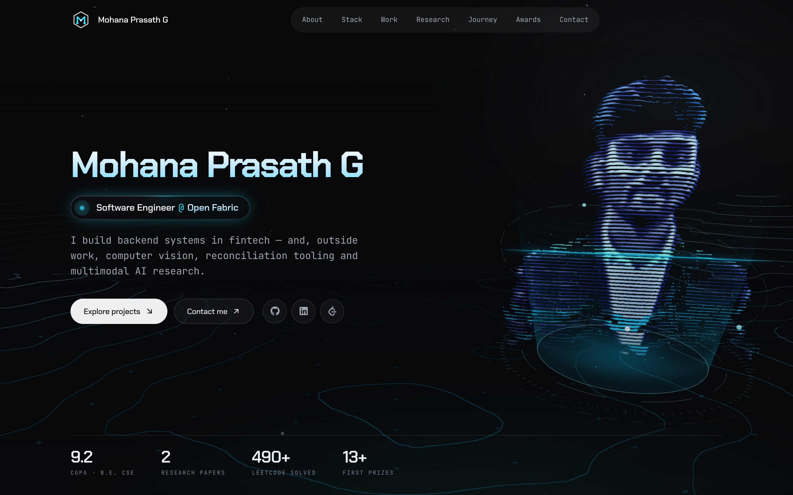

<div align="center">


# Mohana Prasath G

**Software Engineer @ Open Fabric** · fintech backend · computer vision · multimodal AI

<a href="https://mohana-prasath-2005.github.io/portfolio/"></a>



</div>

## The idea

No stock template. My portrait is rebuilt in the browser as a **3D hologram**: one photo becomes thousands of depth-mapped scan-line points that stand on a glowing projector. Behind it, a living topographic terrain glides by as you scroll.

Projects aren't screenshots either. You can **use** them:

- **VISION X**: drag the confidence threshold and watch detections and counts update
- **Reconciliation engine**: watch transactions get matched and mismatches flagged, then re-run it
- **IoT robot car**: real footage of gesture, voice and Bluetooth control

## Built with

React · Three.js / React Three Fiber · custom GLSL · Tailwind CSS · Framer Motion · Vite

It loads text first, falls back gracefully without WebGL, respects reduced motion, and works down to 320 px.

## Run locally

```bash
npm install
npm run dev
```
